<p align="center">
  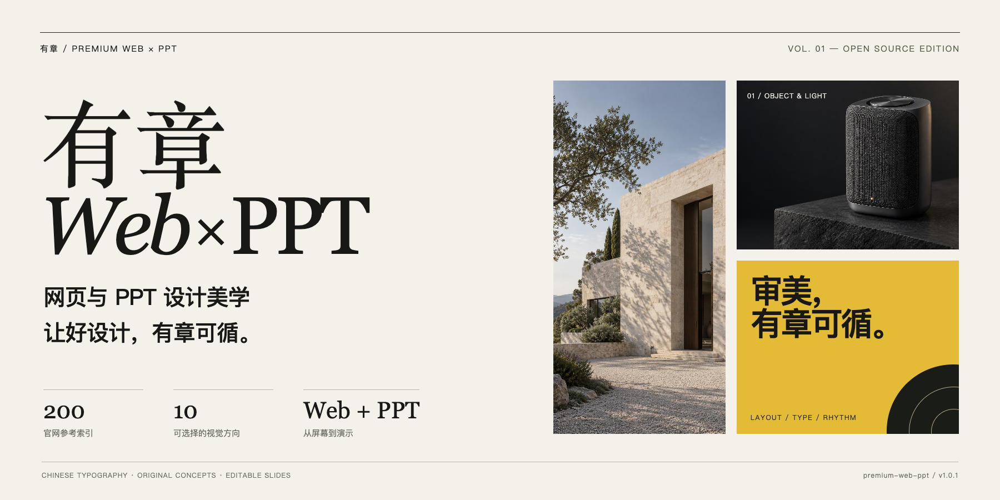
</p>

# 高级官网与PPT美学

**把「高级一点」，变成可以执行的设计判断。**

[在线展示网站](https://michalflowers245-alt.github.io/premium-web-ppt/) · [安装与使用](#安装与使用) · [六组原创案例](#六组原创案例) · [十种风格方向](#十种风格方向) · [200站参考档案](references/source-index.md) · [下载 v1.0.0](https://github.com/michalflowers245-alt/premium-web-ppt/releases/tag/v1.0.0)

`premium-web-ppt` 是一个面向 Codex 的视觉设计 Skill。它将官网参考中的构图、字体、留白、图像和节奏，整理成网页与PPT的制作规则。

建筑项目需要空间与尺度，产品发布需要材质细节，商业方案需要清楚的论证。它会按内容选参考，再把同一套视觉规则延伸到完整作品。

**200条参考索引，17个原材料品类，10种视觉方向。** 包内有20张图集、逐站标签和素材质量说明；基础使用无需下载原始大文件。下面的六组案例均为新制作的原创概念演示，网页有实际HTML，PPT有可编辑源文件。

> A visual design skill for Codex. Turn curated website references into deliberate layouts, Chinese typography, responsive websites, and editable presentations. Includes original examples and an attributed reference atlas.

## 六组原创案例

### 01 / 见山工作室 · 建筑官网

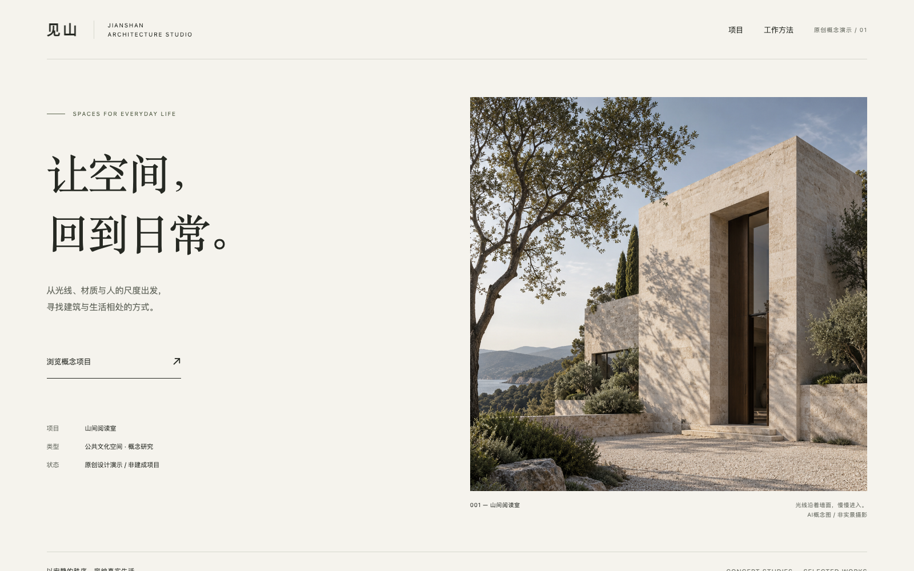

大白边和竖幅摄影控制观看节奏，项目年份、类型与图注放在共同基线上。手机端重新安排图文比例，保留主体与阅读顺序。

[HTML源码与案例说明](examples/web/architecture/) · [手机预览](docs/assets/web-architecture-mobile.png)

### 02 / 未完成的日常 · 艺术活动官网

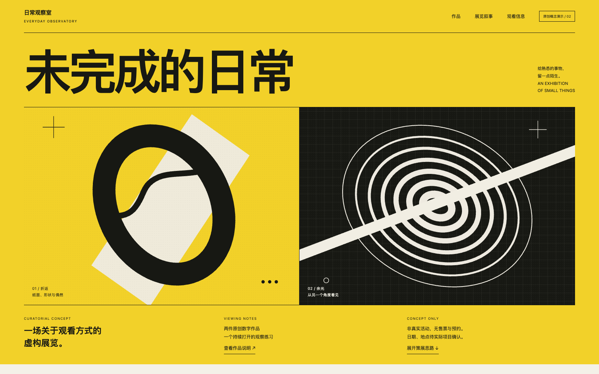

明黄、黑色和双联作品形成第一眼的张力，标题负责表达主题，展讯目录负责交代信息。作品图形为原创，颜色承担分区，文字保持可读。它展示了高饱和、大字和较高密度也能形成有秩序的页面。

[HTML源码与案例说明](examples/web/art/) · [手机预览](docs/assets/web-art-mobile.png)

### 03 / 桌面音箱 · 精密产品官网

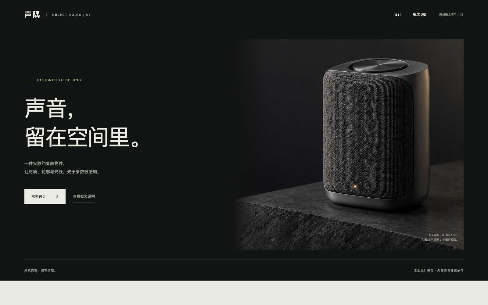

产品在暗场里呈现轮廓与材质，文字落在安静的一侧；下一屏再展开结构与功能。深色页面的质感来自光线、实物细节和尺度关系，说明文字仍然清楚。图片与产品均为概念设计，功能描述按示意呈现。

[HTML源码与案例说明](examples/web/speaker/) · [手机预览](docs/assets/web-speaker-mobile.png)

### 04 / 缓物 · 工艺品牌PPT

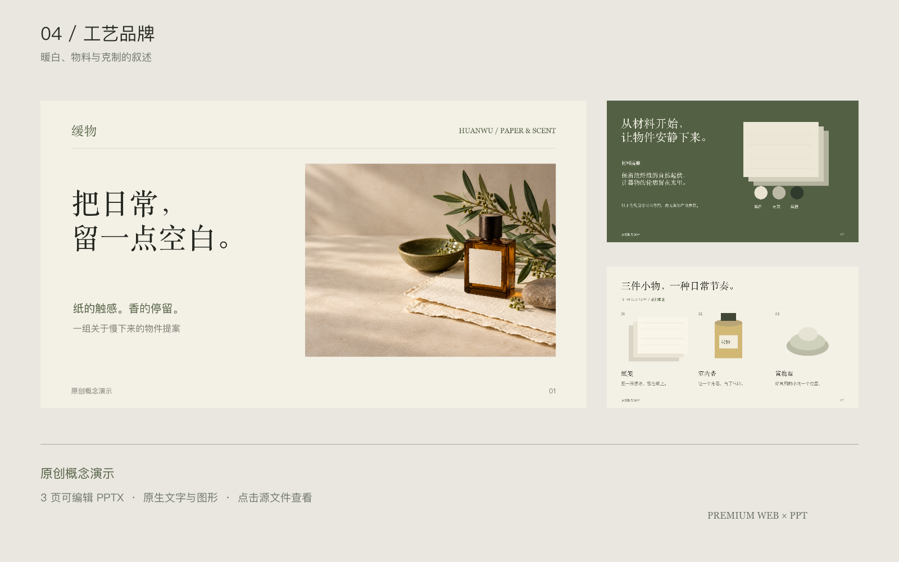

香氛、纸张和植物构成视觉线索，暖白与橄榄色串起封面、材料和系列三页。摄影承担氛围，标题、说明与信息层级保持原生可编辑。图像来自GPT生成的原创静物，未使用真实品牌包装或摄影。

[下载可编辑PPTX](examples/ppt/craft/craft.pptx) · [重建源码](examples/ppt/build.mjs) · [说明与提示词](examples/ppt/README.md) · [逐页预览](examples/ppt/craft/)

### 05 / AI门店试点 · 商务方案PPT

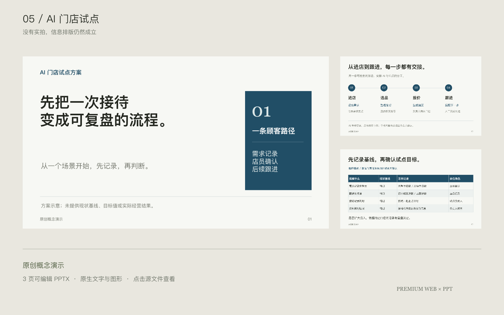

没有门店实拍，也能把方案排得清楚。判断页给出重点，流程页说明顾客与店员的关系，指标页展示需要核查的口径。用编号、细线、列宽和留白处理信息，正文、流程和表格均可编辑；没有虚构收入、客户或试点成效。

[下载可编辑PPTX](examples/ppt/business/business.pptx) · [重建源码](examples/ppt/build.mjs) · [说明与提示词](examples/ppt/README.md) · [逐页预览](examples/ppt/business/)

### 06 / 光的秩序 · 文化策展PPT

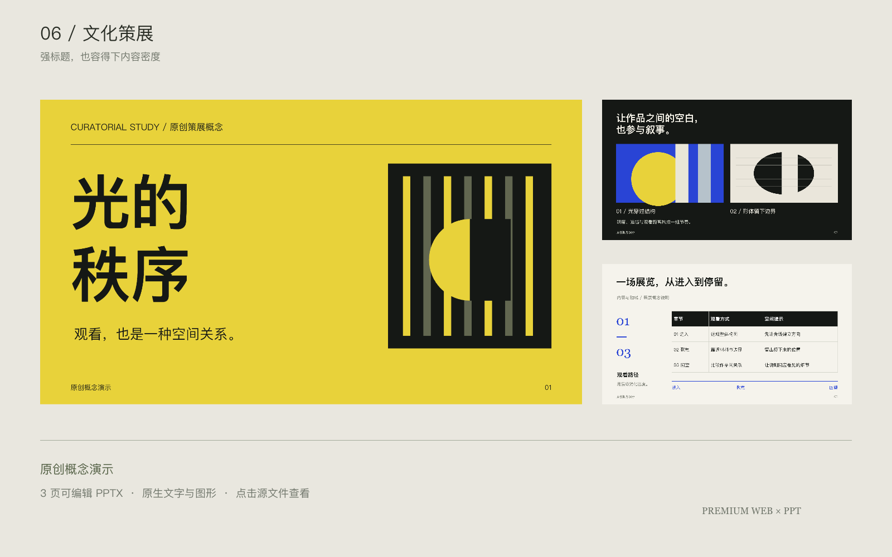

强标题之后，需要能承载细节的内页。这组三页用原创抽象作品、时间线和展览目录建立不同密度，让观看与阅读自然切换。文字和目录依照网格排布，内容充足时依然有明确主次。

[下载可编辑PPTX](examples/ppt/culture/culture.pptx) · [重建源码](examples/ppt/build.mjs) · [说明与提示词](examples/ppt/README.md) · [逐页预览](examples/ppt/culture/)

**以上均为原创概念演示，用于展示工作方式与排版效果；不代表客户项目、已营业场所或商业实绩。** 网页各有独立说明；PPT共用重建脚本与提示词。

## 安装与使用

将仓库安装到你的 Codex 技能目录：

```bash
git clone https://github.com/michalflowers245-alt/premium-web-ppt.git \
  "${CODEX_HOME:-$HOME/.codex}/skills/premium-web-ppt"
```

随后在任务中调用：

```text
用 $premium-web-ppt，把这些内容做成一个高级、清楚的品牌官网。
先看相关参考，自主选择合适的方向，完成桌面和手机预览检查。
```

```text
用 $premium-web-ppt，把这份材料做成12页中文PPT。
保留已有事实与我认可的部分，标题、正文和图表保持可编辑。
```

也可以指定“艺术编辑”“空间材质”等方向，或直接给参考编号。完整输入见[完整提示词](references/master-prompt.md)。它负责视觉判断；实际制作配合环境中可用的网页、演示和生图工具完成，只要求提示词时就交付提示词。

查看HTML示例可在仓库根目录运行 `python3 -m http.server 8000`，再打开对应的 `examples/web/` 页面。基础技能与示例网页不需要安装前端依赖，已导出的PPTX可以直接下载使用。

## 十种风格方向

| 方向 | 适合的内容 | 主要手法 |
|---|---|---|
| 编辑画册 | 作品集、品牌故事 | 图文比例、大白边、稳定图注 |
| 艺术编辑 | 创意机构、活动 | 双联画、硬分屏、展示大字 |
| 古典工艺 | 文化、香氛、物件 | 静物、衬线、材质叙事 |
| 空间材质 | 建筑、家居、体验 | 光线、透视、空间尺度 |
| 作品档案 | 案例、路线图 | 索引、元数据、编辑网格 |
| 精密展陈 | 硬件、制造、技术 | 产品细节、受控光线 |
| 电影摄影 | 品牌发布、场景 | 取景、负空间、短标题 |
| 清晰发布 | 商品、方案介绍 | 大主体、明确阅读与行动 |
| 目的地叙事 | 酒店、餐饮、文旅 | 空间、人物、服务信息 |
| 文化出版 | 展讯、资讯、研究 | 分栏、强标题、信息密度 |

[查看完整配方](references/style-recipes.md)。每次选一个主方向，必要时补充一个辅助维度；按中文长度、图片质量与场景调整配方。

## 从参考到作品

先读内容与约束，再选择2–4个相关参考，明确吸收哪一种关系：图片占比、标题位置、图注系统或项目索引。确定字体、色彩和网格后，完成关键页，再延伸到全稿。最后回到实际浏览器或渲染后的幻灯片，检查阅读顺序、文字、裁切和交互。

网页会考虑手机重排、可见焦点和有效行动入口；PPT会把滚动结构改成逐页叙述。数据的单位、日期、来源和限制随内容保留，审美不能替代事实。

## 官网参考选读

下面是第三方官网参考快照，与上面的原创案例分开记录。每张图仅用于说明可见设计手法，品牌与摄影归原权利人所有，不表示合作或背书。

| 参考 | 参考 |
|---|---|
| 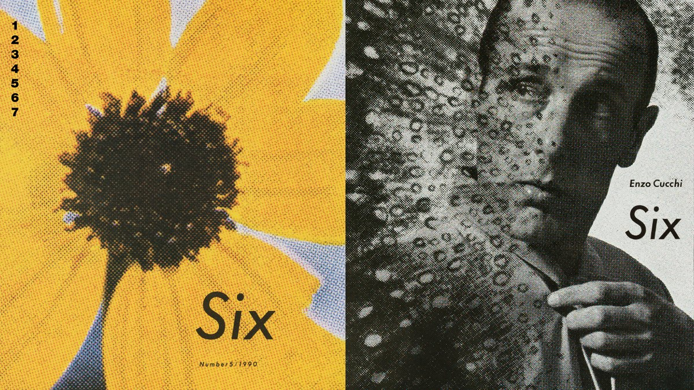<br>**004 Comme des Garçons** · [来源](https://www.comme-des-garcons.com/)<br>借鉴：两幅作品的直接并置。 | 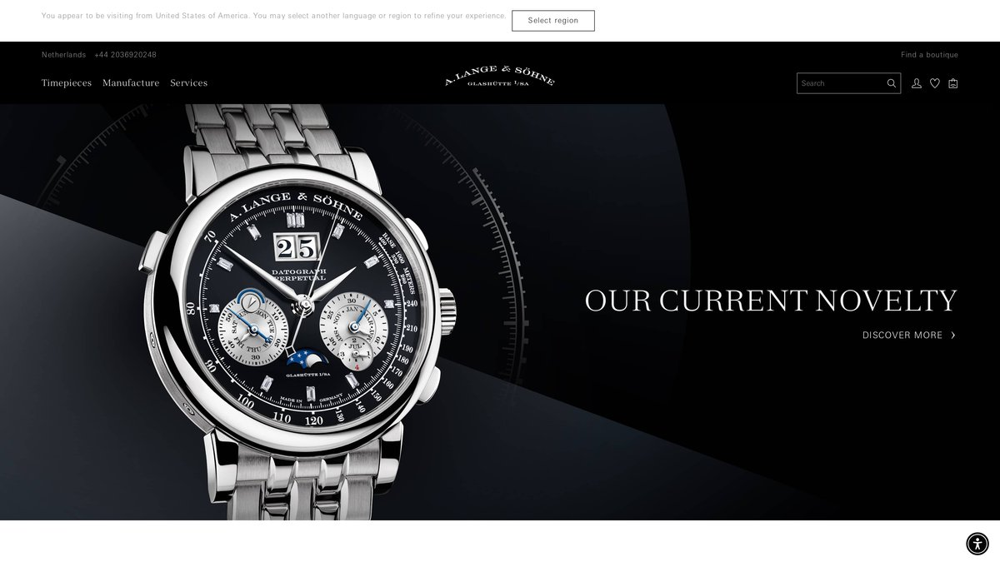<br>**029 A. Lange & Söhne** · [来源](https://www.alange-soehne.com/en)<br>借鉴：产品细节与文字区的尺度。 |
| 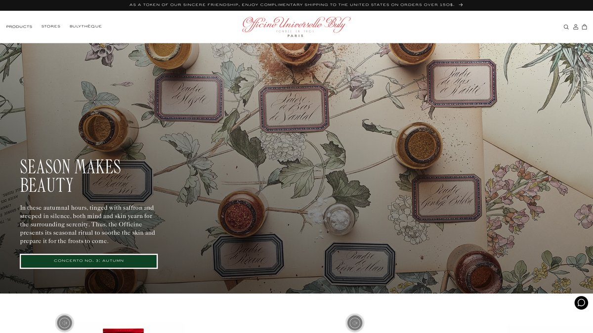<br>**045 Buly** · [来源](https://buly1803.com/en-us)<br>借鉴：物料、插画与编辑层级。 | 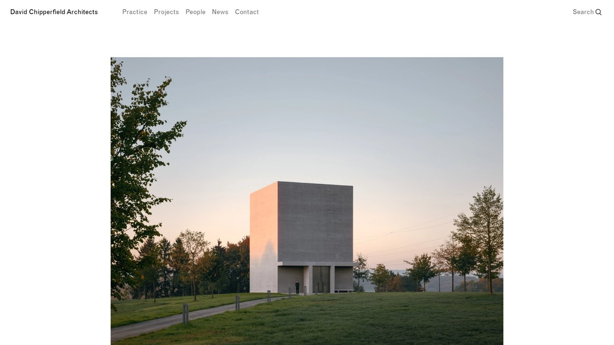<br>**124 David Chipperfield** · [来源](https://davidchipperfield.com/)<br>借鉴：图像边界与留白。 |
| 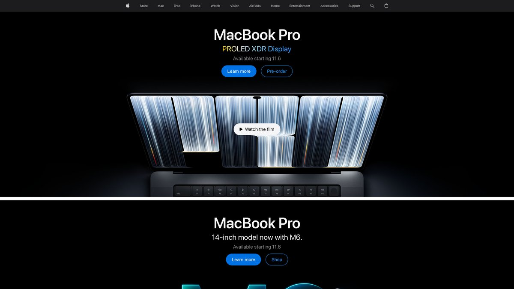<br>**178 Apple** · [来源](https://www.apple.com/)<br>借鉴：单一主对象与信息先后。 | 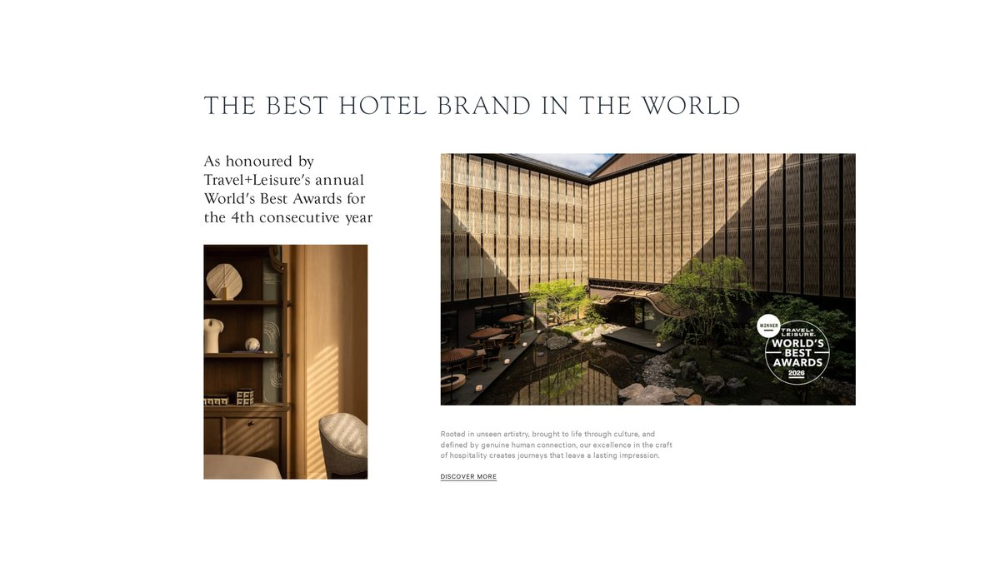<br>**187 Capella Hotels** · [来源](https://capellahotels.com/en)<br>借鉴：大小图与说明的组合。 |

完整资料见[200站索引](references/source-index.md)。已建立200份单站材料的文本和元数据索引，目检200张首图，并放大查看27张代表图；没有逐张精查全部1103张嵌入截图，也未实测现网动效。源材料中的空白、弹窗与疑似错站均有标记，原始探测笔记按资料保留。

## 仓库与素材

- `SKILL.md`：技能入口；`references/`：配方、图集、来源与分析。
- `examples/`：三个网页与三套PPT的源文件、预览和制作说明。
- `scripts/inspect_reference.py`：无需第三方依赖的参考查询工具；Python 3可用。

基础使用只依赖仓库资料。原始PDF与200份PPT没有打包上传；需要提取高清截图时，通过 `--source-root` 指定自己的图鉴目录，详见索引。示例图片使用内置GPT ImageGen生成或原生图形绘制，真实页面和幻灯片另行排版渲染。

原创规则、脚本和原创示例按[MIT许可证](LICENSE)提供。第三方官网截图与图集不在MIT授权范围内，来源与归属见[第三方素材说明](THIRD_PARTY_NOTICES.md)。
