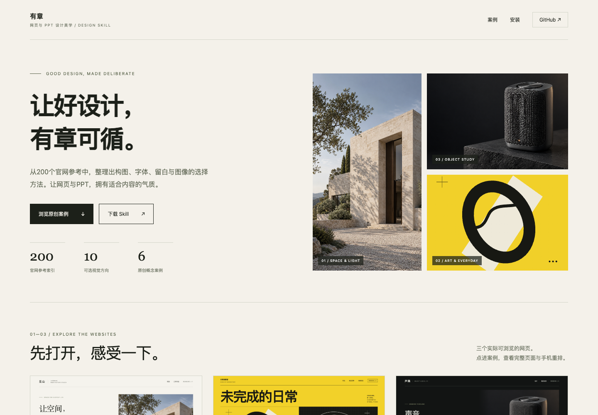
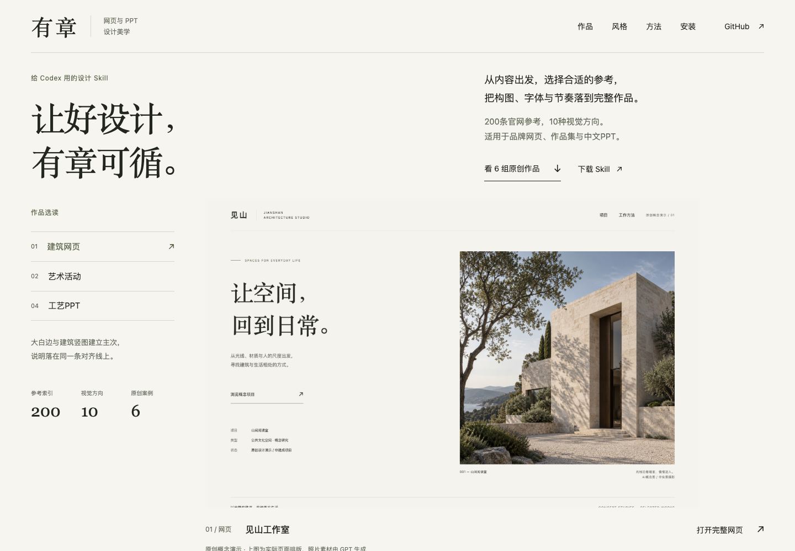

# 用有章，设计有章自己的官网

这次把 `$premium-web-ppt` 用在有章自身的展示网站上。内容、案例、品牌与下载地址沿用已有项目，重新处理它们的观看顺序和阅读层级。

## 先看内容需要什么

网站要回答三个问题：有章是什么、它能做出怎样的页面与幻灯片、怎样开始使用。原版首屏放了建筑和音箱的概念图，实际排版成果在下方缩略图里；三套PPT的内页也难以在组合图中读清。

因此，新的主视觉应直接展示真实页面排版，让作品先说明能力。概念素材、网页、PPT和技能安装分别承担自己的任务。

## 实际查看的三个参考

本次读取本地图鉴的相关原图，没有把它们当成今天的官网状态或已验证的动态交互。

| 参考 | 可见关系 | 迁移到有章的判断 |
|---|---|---|
| 124 · [David Chipperfield Architects](https://davidchipperfield.com/) 首图 | 一张建筑图由统一白边框定，导航退到次级 | 给主要成品足够面积，图片、标题和图注共享边界 |
| 132 · [Pentagram](https://www.pentagram.com/) 第2张 | 图像分组，项目名与说明跟随同一编辑规则 | 用编号和稳定元数据组织案例，让作品之间有可比较的秩序 |
| 187 · [Capella Hotels](https://capellahotels.com/en) 第2张 | 大标题、窄文字列与大小图像形成不对称阅读 | 在共同网格内变化图像尺度，给不同内容不同的停顿 |

主方向选择「编辑画册」，用「作品档案」组织案例。暖白与墨色建立页面骨架，橄榄色仅承担少量强调；艺术与产品本身的颜色留给作品。中文展示字体与正文分别处理，不直接搬用英文网站的小号导航。

以上是对构图和关系的学习。第三方品牌、图片、宣传语和奖项没有成为有章自己的素材或事实。

## 看实际结果

[打开在线官网](https://michalflowers245-alt.github.io/premium-web-ppt/) · [查看首页源码](../index.html) · [查看完整视觉配方](../references/style-recipes.md)

网页、幻灯片和图像案例均保留原创概念演示标识。页面的布局、预览与选择交互是本次新设计，不是对参考站动态效果的实测复刻。

## 这次具体改了什么

- 首屏直接说明“给Codex用的设计Skill”，主视觉使用完整网页或幻灯片排版。三种选读由读者手动切换，图片、图注和打开入口一起变化。
- 六组作品改为有宽窄与停顿的画册，保留编号、类型和稳定说明；可筛选全部、网页或PPT。
- 三套PPT可在页面内逐页放大阅读，支持前后页、方向键、Escape关闭和焦点返回，下载仍指向原可编辑文件。
- 十种风格可展开查看适用内容、手法、相关原创案例与参考索引；从风格跳回被筛掉的案例时，会恢复对应作品。
- 网页与PPT调用例可以切换、复制。安装命令也保留成功和失败提示，方便直接开始下一次任务。

## 改版前后

原版首屏主要呈现生成图像与图形：

新版先呈现实际页面的字体、图像与信息关系：

[查看手机首屏](assets/site-after-mobile.png)。两张桌面图均为1440×1000实际浏览器截图，使用同一批案例；网页实现可直接查看首页源码。

## 实际检查范围

在隔离Chrome中检查320、390、768、1440px四种宽度，并模拟GitHub Pages的项目子路径。图片、锚点、手机菜单、三种主视觉、六组作品筛选、十种风格、三套PPT共九页、键盘与焦点，以及两类复制的成功/失败路径均通过。

另一次独立复核覆盖1440/390px，并检查PPT预览图加载失败时的提示与切换恢复。实际查看了桌面与手机首屏、画册、风格展开及PPT大图；修正了可见中文孤行。验证覆盖上述浏览器与尺寸，其他浏览器和设备仍需另行检查。
